```{python}
#| label: setup
#| code-summary: "Setup: paths, cached results and table helper"
# All heavy computation lives in analysis/ (run_dynamics.py, b_run_models.py) and
# writes cached tables to the gitignored results folder; this page only reads them.
from pathlib import Path

import geopandas as gpd
import numpy as np
import pandas as pd
from IPython.display import Markdown, display

DATA = Path("../../../data/data_python/energy_inequality")
if not DATA.exists():  # rendering from the project root
    DATA = Path("data/data_python/energy_inequality")
PROC = DATA / "processed"
DYN = DATA / "results" / "dynamics" / "tables"
MOD = DATA / "results" / "models" / "tables"


def read(folder, name):
    """Read a cached result table (Parquet if present, else CSV)."""
    pq = folder / f"{name}.parquet"
    return pd.read_parquet(pq) if pq.exists() else pd.read_csv(folder / f"{name}.csv")


def show_table(df, floatfmt=".3f"):
    """Render a data frame as a Markdown table (cross-referenceable via tbl- labels)."""
    display(Markdown(df.to_markdown(index=False, floatfmt=floatfmt)))
```

## Abstract {.unnumbered}

Domestic electricity use is a basic marker of how households live, heat their homes and respond to prices, yet its small-area geography in Great Britain has rarely been followed over time. This study assembles a balanced panel of mean domestic electricity consumption per meter for all 35,672 Lower Layer Super Output Areas (LSOAs) of England and Wales from 2010 to 2024, harmonised to 2021 boundaries from the official sub-national statistics [@desnz2025lsoa]. Consumption is strongly and persistently clustered (Moran's *I* ≈ 0.58 in every year). About three quarters of between-LSOA inequality lies *within* local authorities, and that share has risen. Places keep their relative positions: one-year staying probabilities are 0.70–0.94, the mean first-passage time from the lowest to the highest quintile exceeds a century, and spatial Markov chains show that neighbourhood context cuts the chance of leaving the bottom or top of the distribution by half or more. A Van Kerm decomposition attributes 71–82% of mobility in 2019–22 to the common COVID-19 and price-crisis shocks, and only a small, largely transitory share to re-ranking. Phillips–Sul tests reject national convergence at every scale; local authorities sort into twelve ordered, spatially clustered convergence clubs. Housing and heating composition explains about 80% of the cross-sectional variance, but multiscale geographically weighted regression shows that these associations operate at very different spatial scales, from national (age structure) to local (electric heating, EPC efficiency). Areas with more heat-pump heating in 2021 have drifted steadily upwards relative to the rest of the country, the clearest footprint of the electrification of heat in the data.

**Keywords:** energy inequality; spatial Markov chains; club convergence; place mobility; MGWR; LSOA; England and Wales.

## Introduction

Where people live shapes how much energy they use, how much it costs them and how exposed they are to price shocks. Fuel poverty has long been understood as the meeting point of low income, high prices and an inefficient housing stock [@boardman2010fixing], and each of those conditions is unevenly distributed across space. The energy-justice literature has made this geography explicit: vulnerability is produced through housing, infrastructure networks and local labour markets, and it forms "landscapes" that national averages hide [@walker2012fuel; @bouzarovski2017spatializing]. Area-based policy, from retrofit programmes to the targeting of bill support, depends on knowing where consumption and need are concentrated and whether those places change.

Small-area evidence on *consumption* (as opposed to modelled need) has nevertheless remained mostly cross-sectional. The Department for Energy Security and Net Zero (DESNZ) has published meter-based domestic electricity consumption for every LSOA in Great Britain since 2010 [@desnz2025lsoa; @desnz2026subnational], but the series crosses a change of census geography and of processing system, and it spans three disruptions: the COVID-19 lockdowns, the 2022 energy-price crisis and the early electrification of heat. Whether neighbourhoods are converging, diverging or simply holding their places is unknown.

This study treats per-meter domestic electricity consumption as a distribution of places and asks how that distribution is structured in space and how it moves through time. It brings together tools that are well established for regional income but almost unused for neighbourhood energy: exploratory spatial data analysis, decomposable inequality measures, classic and spatial Markov chains [@rey2001spatial], place-mobility decomposition [@vankerm2004what; @rey2023place], club-convergence tests [@phillips2007transition; @phillips2009economic] and multiscale geographically weighted regression [@fotheringham2017multiscale]. The research was carried out at the University of Liverpool under the supervision of Dr. Ron M. It addresses five questions:

1. **RQ1 – Spatial structure.** Is consumption spatially clustered at the LSOA scale, and how much of its inequality lies within rather than between local authorities?
2. **RQ2 – Dynamics and place mobility.** Do places keep their relative positions, and is their movement conditioned by neighbourhood context?
3. **RQ3 – Convergence clubs.** Is consumption converging nationally, or are places forming distinct, spatially concentrated clubs?
4. **RQ4 – Heterogeneous drivers.** Do dwelling, heating, tenure and efficiency characteristics relate to consumption uniformly, or at different spatial scales?
5. **RQ5 – Shocks and transitions.** Did the pandemic and the 2022 price crisis compress or widen spatial differences?

## Literature review

### Domestic energy as a spatial question of justice

Later scholarship recast fuel poverty as a matter of distributional, recognitional and procedural justice [@walker2012fuel; @jenkins2016energy], and @bouzarovski2017spatializing argue that energy injustice is produced in and through space. The choice of indicator changes both the map of need and the population identified as fuel poor [@robinson2018getting]; small-area prediction models [@fahmy2011predicting] and geographically weighted principal components [@robinson2019spatially] show that vulnerability and its drivers vary between neighbourhoods, and rural households off the gas grid face a distinct risk profile [@roberts2015fuel]. Distributional analysis of energy use borrows its instruments, Lorenz curves and Gini coefficients, from the study of income [@jacobson2005letting]. The analogy needs care at the small-area scale: electricity consumption is not a welfare measure. High use can reflect affluence or electric resistance heating in poorly insulated homes, and low use can reflect efficiency, rooftop solar or households rationing energy [@fawcett2024using].

### Drivers of household electricity demand

Dwelling-level studies agree on a broad hierarchy of determinants. In English gas-heated homes, appliance ownership and use explain the largest share of variation in electricity use and household size leads the socio-demographic factors [@huebner2016understanding]; when total energy is modelled, floor area and dwelling type dominate [@huebner2015explaining; @wyatt2013dwelling], and neighbourhood types differ markedly [@druckman2008household]. Weather is a first-order driver wherever electricity provides heat [@summerfield2010two]. Energy Performance Certificates (EPCs) are the usual proxy for dwelling efficiency [@mhclg2025epc], but the register contains recording errors [@hardy2019analysis], modelled demand diverges from measured demand as ratings worsen [@summerfield2019empirical; @few2023overprediction], and occupants of inefficient homes often use far less than predicted [@sunikkablank2012introducing]. Few studies examine how such relationships vary across space: @feng2025examining find with MGWR that drivers in Nottingham operate at different scales, and @netobradley2023microsimulation show how household practice and local context jointly shape fuel use. National evidence of this kind for England and Wales, followed over time, is largely missing.

### Measuring consumption at small-area scale

DESNZ domestic electricity covers non-half-hourly meters on standard and Economy 7 profiles; the meter year runs from late January to late January; electricity, unlike gas, is not weather-corrected; and meters do not map one-to-one onto households [@desnz2026subnational]. From 2015 the statistics are published on Census 2021 LSOAs with consistent postcode information, while 2010–2014 remain on 2011 boundaries. LSOAs were designed for statistical stability across censuses [@cockings2011maintaining], and ONS publishes an exact-fit lookup that classifies each 2011→2021 change [@ons2021statgeog; @ons2023lsoalookup]. Any zonal system is exposed to the modifiable areal unit problem [@openshaw1984modifiable; @fotheringham1991modifiable]: associations with census covariates describe places, not households.

### Spatial inequality, distribution dynamics and convergence

Moran's *I* [@moran1950notes] and local indicators of spatial association [@anselin1995local] are the standard first account of spatial structure, with false-discovery-rate control for the many dependent local tests [@caldasdecastro2006controlling]. Inequality across places is measured with decomposable indices [@theil1967economics; @shorrocks1980class; @cowell2011measuring] and, spatially, with the spatial Gini [@rey2013spatial; @rey2025spatial]. Static snapshots cannot show whether places change position. Quah's distribution-dynamics approach models the evolution of the whole cross-section with Markov chains [@quah1996twin; @quah1997empirics]; @rey2001spatial conditioned transitions on neighbourhood context, with formal tests of the spatial-Markov property [@rey2016properties; @kang2018conditional] and of time homogeneity [@bickenbach2003evaluating], and LISA Markov chains and directional rose diagrams show how places move jointly with their neighbours [@rey2011visualizing; @rey2016space]. Mobility can be decomposed into growth, dispersion and exchange [@shorrocks1978measurement; @vankerm2004what], as @rey2010interregional and @rey2023place do for Mexican regions. The log *t* test and clustering algorithm of @phillips2007transition [-@phillips2009economic] identify convergence clubs without assuming homogeneous technology; they have been applied to European regions [@bartkowska2012regional] and, for energy, to Chinese provinces [@herrerias2017residential] and Turkish cities [@tastan2023club], but not at neighbourhood scale.

### Explaining spatial heterogeneity and the shocks of 2020–2022

Geographically weighted regression [@brunsdon1996geographically] and its multiscale generalisation [@fotheringham2017multiscale; @oshan2019mgwr] estimate locally varying coefficients, each with its own bandwidth in MGWR; spatio-temporal extensions add a temporal kernel [@huang2010geographically; @fotheringham2015geographical], and fixed-rank basis-function models scale to very large data [@cressie2008fixed; @zammitmangion2021frk; @sainsburydale2024modeling]. Good practice is set out by @comber2023route. The study period contains three disruptions. Lockdowns shifted demand into homes [@bahmanyar2020impact]; smart-meter evidence for Great Britain puts the first-year rise at 7.8% [@zapatawebborn2023impact]. The 2022 price crisis raised household burdens worldwide [@guan2023burden], and winter 2022/23 consumption in Great Britain fell by 8.4% after weather adjustment, with the largest cuts linked to under-heating [@zapatawebborn2024winter; @webborn2021serl]. Meanwhile heat pumps add substantial seasonal load [@love2017addition] and cluster locally [@arvanitopoulos2025decarbonising], while rooftop solar reduces metered imports [@mckenna2018solar; @baltaozkan2015regional].

### Research gap

No study has described the full LSOA-level distribution of domestic electricity consumption in England and Wales over more than a decade with spatially explicit methods; distribution-dynamics, convergence-club and place-mobility tools have not been applied to neighbourhood energy; and the small-area footprint of the pandemic, the price crisis and electrification is unknown. The hypotheses tested below follow from this literature and are summarised, with verdicts, in @tbl-hypotheses.

## Data

### Sources

All inputs are official statistics released under the Open Government Licence v3.0 (@tbl-sources). The outcome is the mean annual domestic electricity consumption per meter (kWh) for each LSOA, taken from the DESNZ release of December 2025, which covers 2010–2024 [@desnz2025lsoa]. Domestic gas consumption from the same release, which DESNZ weather-corrects, is used as a comparison. Covariates come from Census 2021 (central-heating type, dwelling type, rooms, household size, tenure, age), the Index of Multiple Deprivation 2019 for England and the Welsh equivalent (ranked within country), the ONS Rural–Urban Classification 2021, ONS mid-year population estimates and the ONS summary of EPC energy efficiency by MSOA [@mhclg2025epc].

::: {.table-responsive}

| Dataset | Publisher | Geography | Years |
|---|---|---|---|
| Domestic electricity consumption by LSOA | DESNZ | 2011 LSOA (2010–14), 2021 LSOA (2015–24) | 2010–2024 |
| Domestic gas consumption by LSOA (weather-corrected) | DESNZ | as above | 2010–2024 |
| Regional and local-authority electricity statistics | DESNZ | LAD | 2005–2024 |
| LSOA 2021 boundaries and 2011→2021 exact-fit lookups | ONS Open Geography Portal | LSOA, MSOA, LAD (May 2026) | 2021 |
| Census 2021 topic summaries | ONS / Nomis | LSOA 2021 | 2021 |
| Energy efficiency of housing (EPC) | ONS | MSOA | to FYE 2025 |
| IMD 2019 / WIMD 2019 | MHCLG / Welsh Government | LSOA 2011 → 2021 | 2019 |
| Mid-year population estimates | ONS | LSOA 2021 | 2011–2024 |

: Data sources. {#tbl-sources}

:::

### Study area and harmonisation

The study covers England and Wales: 35,672 LSOAs (2021), 7,264 MSOAs and 318 local authority districts (LADs, May 2026 vintage). Scotland is excluded because its Data Zones are not comparable with LSOAs and the EPC and census covariates differ. DESNZ publishes 2015–2024 directly on 2021 LSOAs, so only 2010–2014 had to be converted. Using the ONS exact-fit lookup, 33,647 LSOAs are unchanged and 119 are merges, for which meters and consumption are summed exactly. The 1,900 splits and 6 irregular changes are apportioned by Census 2021 household counts at output-area level, and the mean is recomputed as total kWh ÷ meters. National totals are conserved exactly. Because split LSOAs inherit their parent's mean in 2010–2014, every result that touches those years is repeated without them, and **2015–2024**, which uses one geography and one DESNZ processing system, is the core period for dynamics.

Nothing is dropped silently. LSOA-years with fewer than 50 meters, implausibly low means, extreme robust *z*-scores or one-year spikes are flagged (0.26% of electricity LSOA-years) and every result is repeated without them. The balanced analysis panel contains 35,636 LSOAs observed in all fifteen years. Local-authority series are built as total kWh ÷ total meters summed from LSOAs, never as an average of LSOA means; they agree with the official local-authority tables to within a few kWh, and the unallocated meters that DESNZ withholds for disclosure control are at most 0.27% in any year. *Relative consumption*, the LSOA (or LAD) mean divided by the meter-weighted England and Wales mean for the year, removes common shocks and is used for maps and dynamics.

```{python}
#| label: tbl-national
#| tbl-cap: "National trajectory: meter-weighted mean, median LSOA mean and dispersion of domestic electricity consumption per meter, England and Wales."
s = read(DYN, "esda_summary_stats")
mi = read(DYN, "esda_moran_global").query("weights == 'queen' and variable == 'level'")
t = s.merge(mi[["year", "I"]], on="year")
t = t[["year", "mean_meter_weighted", "median", "cv", "skewness_log", "p90_p10", "I"]]
t.columns = ["Year", "Mean (kWh)", "Median LSOA (kWh)", "CV", "Skew (log)", "P90/P10", "Moran's I"]
t["Mean (kWh)"] = t["Mean (kWh)"].round(0).astype(int)
t["Median LSOA (kWh)"] = t["Median LSOA (kWh)"].round(0).astype(int)
show_table(t)
```

Mean consumption fell by a fifth, from 4,148 kWh per meter in 2010 to 3,343 kWh in 2024 (@tbl-national). The two exceptions are 2020, when lockdowns pushed it up by 4.9%, and 2022, when the price crisis cut it by 8.8%. The coefficient of variation and the log skewness both rose, so the distribution became wider and more right-skewed while its centre fell.

### Caveats that apply throughout

- **Meters are not households.** Per-meter means mix dwelling size, heating fuel, occupancy, Economy 7 tariffs, empty and second homes. Every result is a place-level (ecological) association.
- **Weather.** Electricity is not weather-corrected, so some year-to-year movement, particularly in the national level, reflects winter temperatures. Relative measures remove the common part.
- **Two geographies and two processing systems.** The 2014→2015 boundary is tested explicitly as a break.
- **Over-powered tests.** With 35,000 units almost any difference is "significant", so effect sizes and permutation-based inference are reported alongside asymptotic *p*-values.

## Methods

All analysis is in Python, using PySAL [@rey2022pysal] (`esda`, `libpysal`, `giddy`, `inequality`, `mapclassify`, `spreg`, `mgwr`) with `geopandas`, `statsmodels` and `scikit-learn`. The pipeline (`prep/` for data, `analysis/` for models) runs end to end from the raw downloads; every random seed is fixed and heavy fits are cached.

### Spatial weights and exploratory analysis

The main weights are queen contiguity on the 2021 LSOA polygons, row-standardised (5.84 neighbours on average; the Isles of Scilly are joined to their nearest LSOA). Eight nearest neighbours on population-weighted centroids are the robustness alternative. Global spatial autocorrelation is measured by Moran's *I* [@moran1950notes],

$$
I = \frac{n}{\sum_i \sum_j w_{ij}} \, \frac{\sum_i \sum_j w_{ij} (x_i - \bar{x})(x_j - \bar{x})}{\sum_i (x_i - \bar{x})^2},
$$ {#eq-moran}

and local clusters by the local Moran statistic $I_i = z_i \sum_j w_{ij} z_j$ [@anselin1995local], with 999 and 9,999 conditional permutations respectively and Benjamini–Hochberg control of the false discovery rate at 5% [@caldasdecastro2006controlling]. Kernel densities of log relative consumption use Silverman's bandwidth [@silverman1986density]; maps use seven Fisher–Jenks classes [@fisher1958grouping; @jenks1967data] estimated once on a sample of the pooled 2015–2024 values [@rey2017evaluation] so that maps are comparable over time.

### Inequality

The meter-weighted Theil index decomposes exactly into nested components [@theil1967economics; @shorrocks1980class]:

$$
T = \sum_{i} s_i \ln\frac{x_i}{\bar{x}} = \underbrace{\sum_{r} s_r \ln\frac{\bar{x}_r}{\bar{x}}}_{\text{between regions}} + \underbrace{\sum_{r}\sum_{l \in r} s_l \ln\frac{\bar{x}_l}{\bar{x}_r}}_{\text{between LADs within regions}} + \underbrace{\sum_{l} s_l T_l}_{\text{within LADs}},
$$ {#eq-theil}

where $s$ denotes shares of total consumption. The between-LAD part is tested against 999 random relabellings of LSOAs to LADs of the same size. The spatial Gini [@rey2013spatial] splits the Gini numerator into neighbour and non-neighbour pairs,

$$
G = \frac{\sum_i \sum_j w_{ij}\,|x_i - x_j|}{2 n^2 \bar{x}} + \frac{\sum_i \sum_j (1-w_{ij})\,|x_i - x_j|}{2 n^2 \bar{x}},
$$ {#eq-sgini}

with permutation inference on the non-neighbour term. Within each LAD the dispersion of LSOA means (CV, meter-weighted CV and quartile coefficient of dispersion) is related to the LAD level by Spearman correlation with bootstrap intervals and by OLS and spatial-error regressions [@arraiz2010spatial].

### Distribution dynamics

Each year, units are assigned to five classes of relative consumption with pooled 2010–2024 quintile bounds, fixed across windows. The maximum-likelihood transition probabilities of the first-order Markov chain are $\hat{p}_{ij} = n_{ij} / \sum_j n_{ij}$ [@quah1996twin]. From the transition matrix $P$ we derive the ergodic distribution, mean first passage times, sojourn times $1/(1-p_{ii})$ and the Shorrocks index $M = (k - \operatorname{tr} P)/(k-1)$ [@shorrocks1978measurement]. The spatial Markov chain estimates a separate $P$ for each quintile of the spatial lag [@rey2001spatial]; spatial and temporal homogeneity are tested with the likelihood-ratio and $Q$ statistics of @bickenbach2003evaluating and with a permutation test that does not assume independent transitions [@rey2016properties; @kang2018conditional]. LISA Markov chains track moves between Moran-scatterplot quadrants, and directional rose diagrams [@rey2011visualizing] test whether places and their neighbours move together more often than spatial randomness implies.

### Place mobility and rank concordance

Following @vankerm2004what as applied to places by @rey2023place, mobility between years $t_0$ and $t_1$ is the mean absolute change across places, $M = \frac{1}{n}\sum_i |y_{i,t_1} - y_{i,t_0}|$, measured in log points. It is decomposed into a **growth** component (the end-year mean is switched on), a **dispersion** component (the end-year shape of the distribution, with ranks held) and an **exchange** component (end-year ranks), each a Shapley value over all orderings so that the three sum exactly to the total [@shorrocks2013decomposition]. Rank concordance is measured by Kendall's $\tau_b$, by spatial $\tau$ over contiguous pairs and by local neighbour $\tau$ [@rey2016space], with a value-matched null that compares neighbours with random pairs of equally similar starting values.

### Club convergence

The log *t* test of @phillips2007transition is applied to Hodrick–Prescott-filtered log consumption ($\lambda = 400$) [@hodrick1997postwar]. With relative transition paths $h_{it} = X_{it} / N^{-1}\sum_i X_{it}$ and their cross-sectional variance $H_t$, the regression

$$
\log\frac{H_1}{H_t} - 2\log\log t = \hat{a} + \hat{b}\log t + \hat{u}_t, \qquad t = [rT], \dots, T, \; r = 1/3,
$$ {#eq-logt}

rejects convergence when the Newey–West *t*-statistic on $\hat{b}$ falls below −1.65 [@newey1987simple]. Clubs are found with the clustering-and-merging algorithm of @phillips2009economic, following the logic of *ConvergenceClubs* [@sichera2019convergenceclubs], in a vectorised implementation validated by Monte Carlo (adjusted Rand index 0.985–1.000 against planted clubs). LADs are the main specification; MSOAs, LSOAs, a pre-shock window (2010–2019), a post-break window (2015–2024) and a levels variant are robustness checks. Because clubs are a-spatial by construction, membership is tested for spatial clustering with join counts and Moran's *I*, and profiled by ordered logit [@mccullagh1980regression].

### Explanatory models

Cross-sectional models explain log mean consumption in 2022–2024 (and 2019 as a pre-crisis comparison) with standardised 2021 covariates screened by variance inflation (maximum VIF 4.8). At LSOA level, OLS with robust Lagrange-multiplier diagnostics [@anselin1996simple] is followed by SLX [@hallekvega2015slx], spatial lag, spatial error and Durbin-type models, estimated by GMM/IV because maximum likelihood is infeasible at $n = 35{,}662$ [@kelejian2010specification], with LeSage–Pace impacts [@lesage2009introduction]. Local models are fitted at MSOA level ($n = 7{,}264$), where the EPC covariate is native and means rest on about 3,600 meters each. MGWR [@fotheringham2017multiscale; @oshan2019mgwr] estimates

$$
y_i = \sum_{j=0}^{k} \beta_{bw_j}(u_i, v_i)\, x_{ij} + \varepsilon_i,
$$ {#eq-mgwr}

with a separate adaptive bisquare bandwidth $bw_j$ for each covariate, selected by AICc through backfitting. Local inference uses the corrected critical *t* of @dasilva2016multiple. Because the reference implementation would take more than 100 hours at this size, inference was computed with a vectorised re-implementation that reproduces the `mgwr` package to within $4\times10^{-13}$ on a validation subsample.

**Change models** relate the log change in consumption, 2010–12 → 2022–24 (long) and 2019 → 2022 (shock), to the same 2021 baselines, the log change in meter counts (new-build growth) and the initial level, which turns each model into a conditional β-convergence regression [@barro1992convergence]. A **spatio-temporal** analysis replaces a GTWR, whose temporal coefficients would not be identified with census-only covariates [@huang2010geographically], by two identified alternatives: a two-way fixed-effects event study interacting year dummies with 2021 baselines, and a basis-function trend surface in the spirit of Fixed Rank Kriging [@cressie2008fixed; @zammitmangion2021frk], fitted by cross-validated ridge regression on 458 multi-resolution spatial and 10 temporal basis functions.

## Results

### Spatial structure

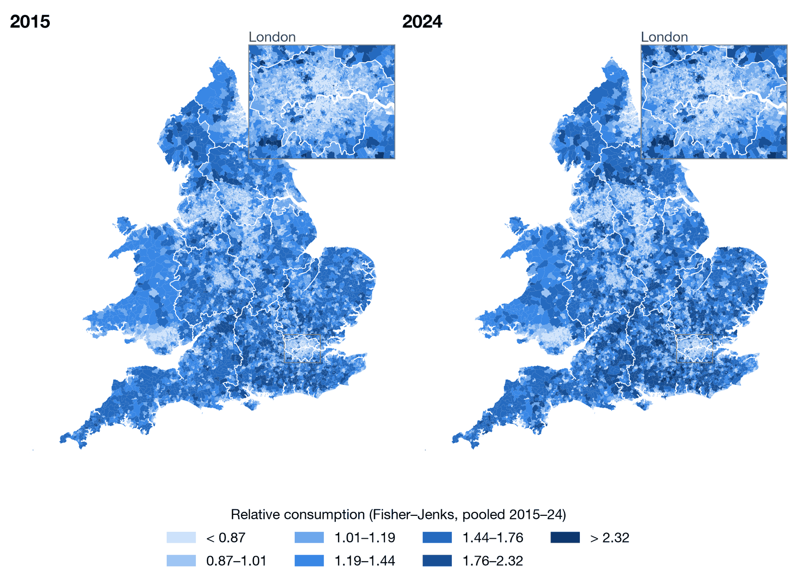{#fig-map fig-alt="Two choropleth maps of England and Wales LSOAs showing relative electricity consumption in 2015 and 2024, with a London inset. Rural areas are darker (higher), cities lighter."}

Per-meter consumption has a clear and stable geography (@fig-map). It is highest across rural England and Wales: Cornwall and Devon, the Welsh uplands, Cumbria and North Yorkshire, Lincolnshire, East Anglia and the outer South East. It is lowest in inner London, Tyneside and Teesside, the South Wales valleys and the Pennine conurbations. The distribution is unimodal in every year, with no sign of "twin peaks"; its mode drifted from 0.92 to 0.89 of the mean between 2015 and 2024 as the upper tail lengthened (@fig-kde).

::: {layout-ncol=2}
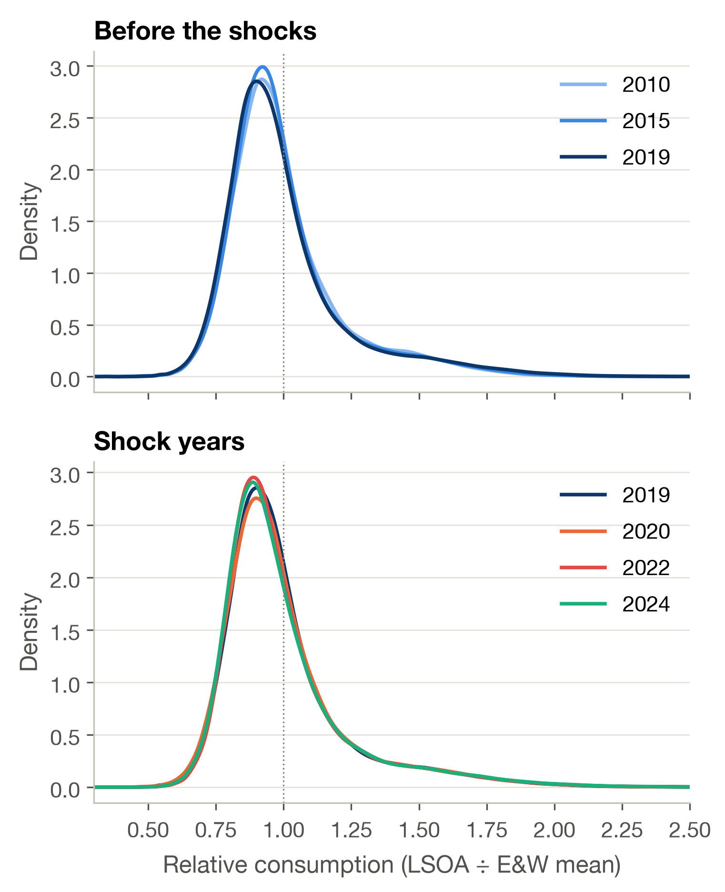{#fig-kde}

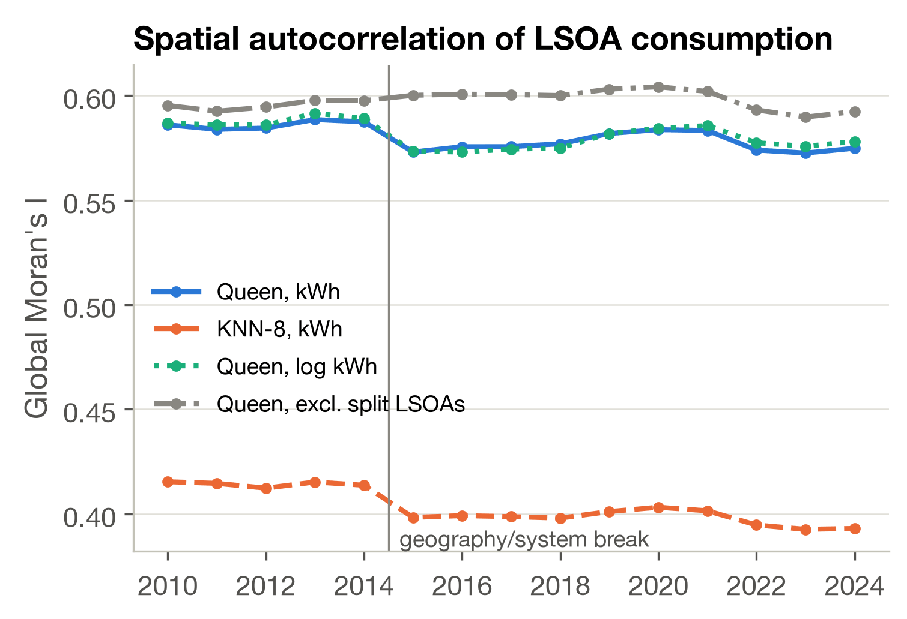{#fig-moran}
:::

Global Moran's *I* lies between 0.57 and 0.59 under contiguity in every year (pseudo-*p* = 0.001 in all years, weights and transformations; @fig-moran), and barely moves through the pandemic and the price crisis even though mean consumption fell by a fifth. With eight nearest neighbours it is about 0.40: rural LSOAs are large, so contiguity gives them few, similar neighbours, while KNN reaches further. Without split LSOAs the series shows no step at 2015 (0.598 in 2014, 0.600 in 2015). After FDR correction about 17% of LSOAs belong to significant local clusters, high–high in rural and off-gas areas and low–low in the conurbations (@fig-lisa); spatial outliers are rare.

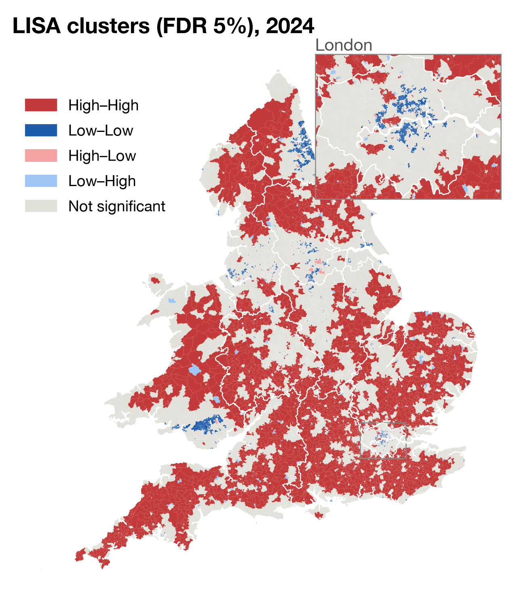{#fig-lisa fig-alt="LISA cluster map of England and Wales showing high-high clusters in rural areas and low-low clusters in cities."}

### Inequality: mostly local and rising

```{python}
#| label: tbl-theil
#| tbl-cap: "Meter-weighted Theil index and its exact three-level decomposition (% of total), with the LSOA Gini and the spatial polarisation index."
th = read(DYN, "ineq_theil")
t = th[["year", "theil_T", "share_between_region", "share_between_lad_within_region", "share_within_lad"]].copy()
for c in t.columns[2:]:
    t[c] = (100 * t[c]).round(1)
t = t[t.year.isin([2010, 2015, 2019, 2020, 2021, 2022, 2023, 2024])]
t.columns = ["Year", "Theil T", "Between regions %", "Between LADs in region %", "Within LADs %"]
show_table(t, floatfmt=(".0f", ".4f", ".1f", ".1f", ".1f"))
```

Inequality between LSOAs is modest in absolute terms (Gini 0.11–0.12) but rose: the Theil index grew by about a fifth between 2015 and 2021 (@tbl-theil). Roughly three quarters of it lies **within** local authorities, a share that rose from 73% to 76%, and almost a third lies within MSOAs; regions account for less than a tenth. The between-LAD component is about 25 times its permutation expectation (*p* = 0.001), and the same split holds for the mean log deviation and for unweighted indices. The spatial Gini confirms that the inequality is spatially organised: contiguous LSOAs differ on average by 30% less than random pairs, and the non-neighbour component exceeds its permutation expectation in every year (*z* = 101–116).

::: {layout-ncol=2}
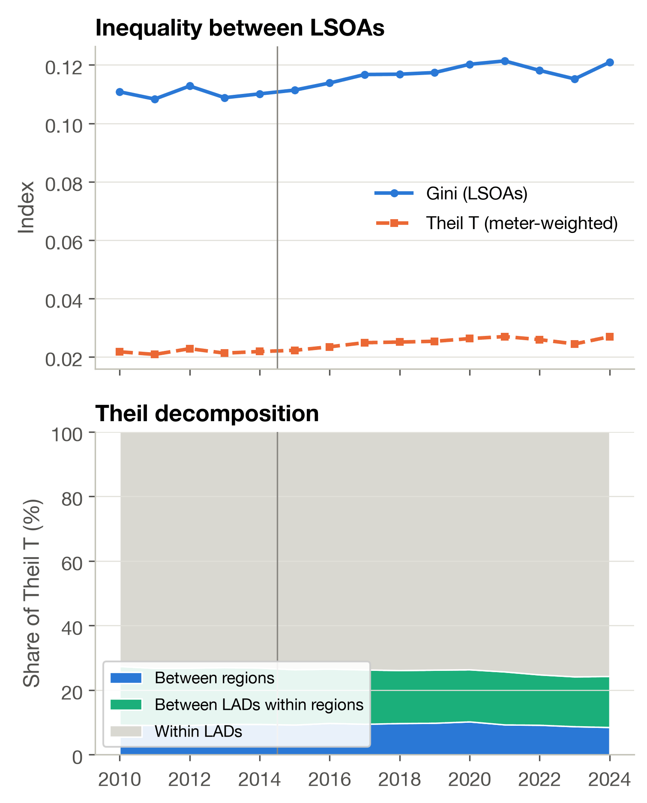{#fig-theil}

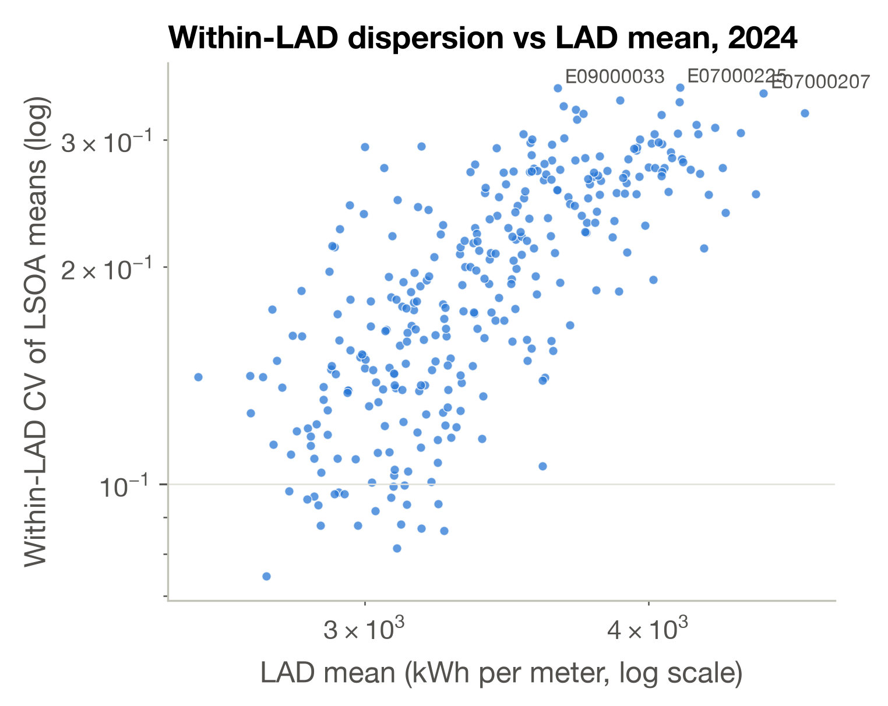{#fig-cv}
:::

Within-LAD dispersion rises steeply with LAD consumption (@fig-cv). Spearman's ρ between the CV and the LAD mean is 0.68 [0.61, 0.74] in 2010 and 0.75 [0.70, 0.80] by 2022–24, and the elasticity of the CV with respect to the mean is about 2.5. The relationship survives a tail-robust dispersion measure, the removal of outlier LSOAs, region fixed effects and LAD size, a spatial-error specification, and the LAD median as the level, so it is not a mechanical tail artefact. The highest-consumption authorities are largely rural LADs where electrically heated, off-gas-grid neighbourhoods sit beside gas-heated market towns.

The price crisis compressed relative differences only briefly (@fig-shock). In 2021→22 the highest-consumption quintile cut consumption by 9.6% and the least deprived quintile by 10.0%, against 6.8% in the lowest-consumption and most deprived quintiles; the gradient is monotonic. The Gini fell from 0.121 to 0.115 by 2023 but returned to 0.121 in 2024. In 2019→20 the gradient reversed: the least deprived areas rose most (+5.9%), consistent with home working concentrated among higher-income households [@zapatawebborn2023impact]. Smaller cuts in deprived areas fit evidence that the poorest households had little left to cut [@zapatawebborn2024winter; @fawcett2024using]; lower consumption there is not a better outcome.

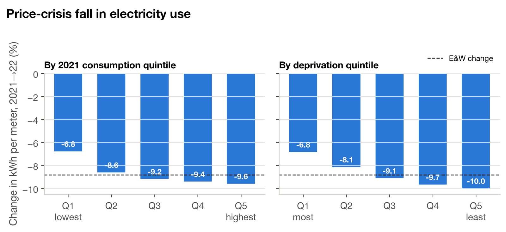{#fig-shock width=80%}

### Distribution dynamics: persistence, conditioned by neighbourhood

```{python}
#| label: tbl-markov
#| tbl-cap: "Classic Markov transition matrix of relative consumption quintiles, LSOAs 2015–2024 (320,724 transitions), with sojourn times and ergodic distribution."
mm = read(DYN, "markov_matrices").query("chain == 'lsoa 2015-24 (core)' and matrix == 'P'")
P = mm.pivot(index="from", columns="to", values="value")
order = sorted(P.index, key=lambda s: s[:2])
P = P.loc[order, order]
summ = read(DYN, "markov_summary").set_index("chain").loc["lsoa 2015-24 (core)"]
P["Sojourn (yrs)"] = [summ[f"sojourn_{k}"] for k in range(1, 6)]
P["Ergodic"] = [summ[f"steady_{k}"] for k in range(1, 6)]
P.columns = [c.split(" ")[0] for c in P.columns[:5]] + list(P.columns[5:])
P.insert(0, "From \\ to", [c.split(" ")[0] for c in order])
show_table(P)
```

Places keep their relative positions (@tbl-markov). Between 70% and 94% of LSOAs stay in the same quintile from one year to the next; the extremes are the most persistent (0.88 for the lowest quintile, 0.94 for the highest), and moves almost always go to an adjacent class. For LADs the diagonals are 0.88–0.96. The mean first-passage time from the lowest to the highest quintile is 128 years for LSOAs and 230 years for LADs. The first-order chain, if anything, *understates* persistence: the Markov property is rejected, and the observed five-year probability of remaining in Q1 (0.85) or Q5 (0.91) is far higher than $P^5$ implies (0.63 and 0.76). Much apparent annual mobility near class boundaries is transitory back-and-forth from estimated readings, meter churn and weather.

::: {layout-ncol=2}
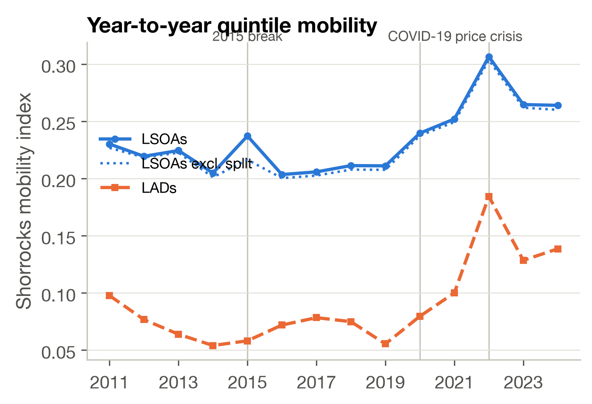{#fig-shorrocks}

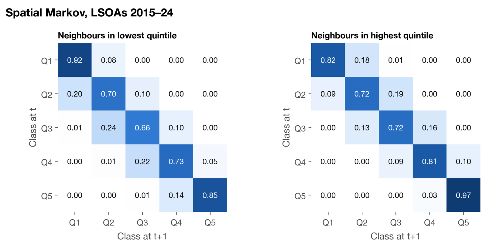{#fig-smarkov}
:::

Mobility was lowest in 2015–19, rose through the pandemic and peaked in 2021→22, when the Shorrocks index reached 0.31 for LSOAs and 0.18 for LADs (@fig-shorrocks). Time homogeneity is rejected, but the largest change in any transition probability between sub-periods is only 0.05. The 2014→15 transition is more mobile than its neighbours; about two thirds of that excess disappears without split LSOAs and none is visible for LADs, so it is mostly a boundary-conversion artefact.

Neighbourhood context conditions movement strongly and symmetrically (@fig-smarkov). Spatial homogeneity is rejected by the analytical tests (*Q* = 6,150, df = 80) and by a permutation test (observed χ² 6,150 against a permutation maximum of 176). A low-consumption LSOA surrounded by low-consumption neighbours leaves the bottom quintile with probability 0.08, against 0.19 when its neighbours are in the top quintile; a high-consumption LSOA among high-consumption neighbours drops out of the top quintile with probability 0.03, against 0.16 among low-consumption neighbours. The conditional ergodic distributions are near mirror images (59% in Q1 under the lowest lag class, 59% in Q5 under the highest). The LISA Markov chain agrees: 92.1% of LSOA-years keep their quadrant, and significant high–high clusters last 17 years on average. The rose diagrams show that when LSOAs move, they move *with* their neighbours far more often than spatial randomness predicts (@fig-rose).

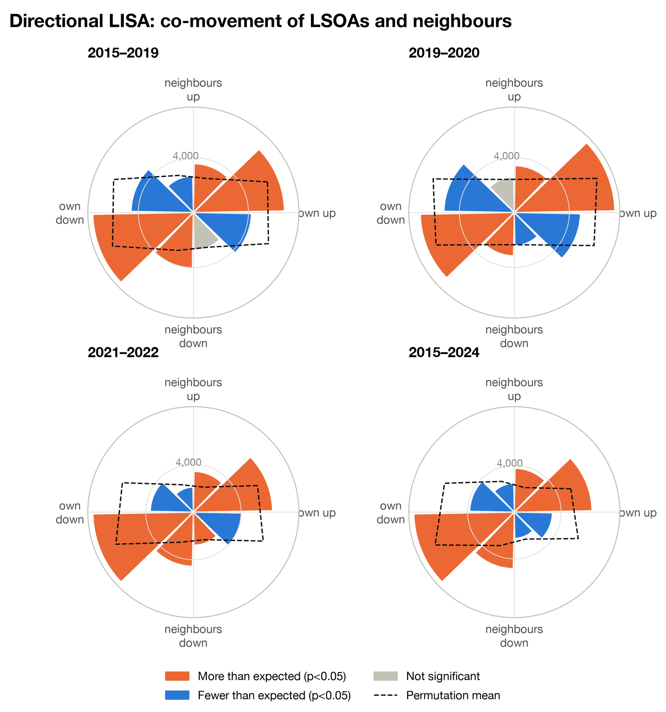{#fig-rose width=80%}

These are descriptive dependencies, not identified spillovers: shared exposure to climate, housing stock and the gas grid would produce the same pattern.

### Place mobility: common shocks, little re-ranking

```{python}
#| label: tbl-vankerm
#| tbl-cap: "Van Kerm decomposition of LSOA mobility (mean absolute change in log consumption × 100) into growth, dispersion and exchange (Shapley values)."
vk = read(DYN, "mobility_vankerm").query("scope == 'LSOA' and index == 'log'")
wins = [(2019, 2020), (2020, 2021), (2021, 2022), (2023, 2024), (2015, 2019), (2019, 2022), (2015, 2024), (2010, 2024)]
rows = []
for a, b in wins:
    r = vk[(vk.from_year == a) & (vk.to_year == b)].iloc[0]
    rows.append({"Window": f"{a}→{b}", "Total": 100 * r.total, "Growth": 100 * r.growth,
                 "Dispersion": 100 * r.dispersion, "Exchange": 100 * r.exchange,
                 "Growth share %": 100 * r.share_growth, "Exchange share %": 100 * r.share_exchange})
show_table(pd.DataFrame(rows), floatfmt=".1f")
```

The decomposition separates the common shocks from the re-sorting of places (@tbl-vankerm, @fig-vankerm). Between 2019 and 2022, 71–82% of LSOA mobility, and over 90% for LADs, is the national level moving up with COVID-19 and then sharply down with the price crisis. In calm years exchange dominates, but it is small and roughly constant (1.3–2.2 log points a year) and accumulates to only 2.4 points over 2015–24: if annual re-rankings were permanent they would sum to more than 13 points, so most reverse. Dispersion is consistently the smallest component. Kendall's $\tau_b$ between consecutive years is 0.86–0.90 for LSOAs (lowest in 2021→22) and falls to 0.76 over 2015–24 (@fig-tau). Spatial $\tau$ is below global $\tau$, but against a value-matched null neighbouring LSOAs re-rank no more than equally similar random pairs, and no local hotspot of re-ranking survives FDR correction.

::: {layout-ncol=2}
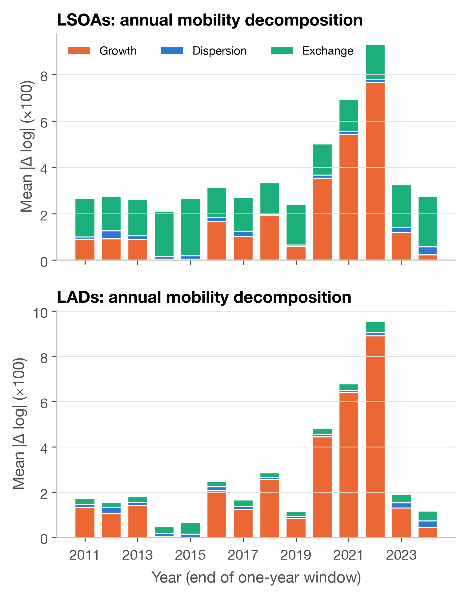{#fig-vankerm}

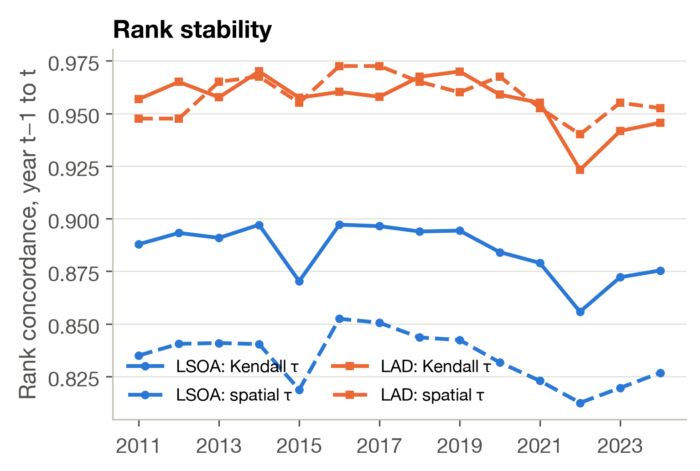{#fig-tau}
:::

### Convergence clubs

```{python}
#| label: tbl-clubs
#| tbl-cap: "Phillips–Sul log t tests and club clustering by scale and window."
cs = read(MOD, "clubs_summary").query("club == 'all'")
win = {"full": "2010–24", "pre": "2010–19", "post15": "2015–24", "levels": "2010–24 (levels)"}
t = pd.DataFrame({
    "Scale": cs.level.str.upper(), "Window": cs.window.map(win), "Units": cs.n.astype(int),
    "b̂": cs.beta, "t": cs.t, "Initial clubs": cs.n_initial_clubs.astype(int),
    "Final clubs": cs.n_final_clubs.astype(int), "Divergent": cs.n_divergent.astype(int)})
show_table(t, floatfmt=(None, None, ".0f", ".2f", ".1f", ".0f", ".0f", ".0f"))
```

There is no evidence of national convergence. The log *t* test rejects it decisively at every scale and in every window (@tbl-clubs): before COVID-19, after the processing break, and when common proportional shocks are removed by working in levels. Relative dispersion rose (σ-divergence: the cross-LAD CV went from 0.117 in 2010 to 0.129 in 2024), so the absolute fall in consumption did not narrow relative gaps. Local authorities instead sort into twelve ordered clubs whose relative transition paths were largely fixed by 2010 (@fig-paths): the top clubs drift slowly upwards and the bottom clubs slowly downwards. The *ordering* of clubs is robust across windows, scales and transformations (rank correlations 0.85–0.98); exact club boundaries are not (adjusted Rand 0.14–0.37), so clubs should be read as ordinal strata.

::: {layout-ncol=2}
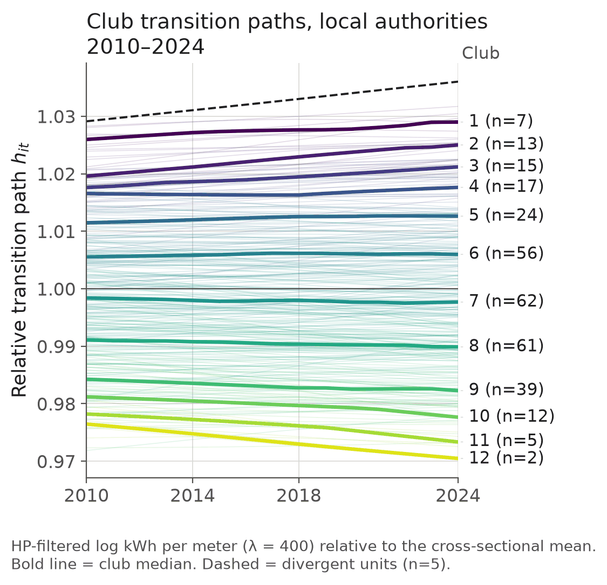{#fig-paths}

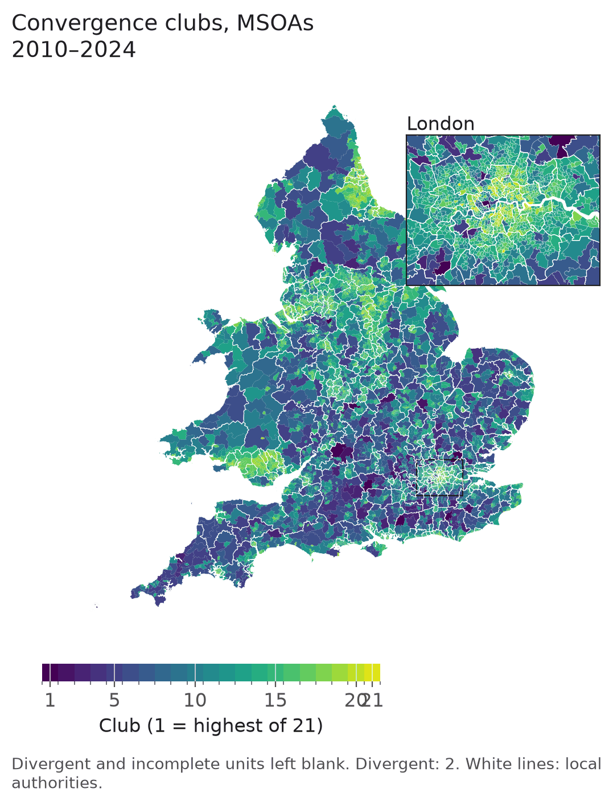{#fig-clubmap}
:::

Club membership is strongly geographical. The share of neighbour links joining units of the same club is 1.2–1.8 times its random expectation, and Moran's *I* of the club number is 0.41–0.58 (all *p* ≤ 0.023). High clubs cover the affluent, detached and partly off-gas commuter belts of the South East and East of England together with rural Wales and the South West; low clubs cover Tyneside, Teesside, the South Wales valleys and inner London (@fig-clubmap). In an ordered logit on 2021 characteristics (@fig-profile), a 1-SD higher share of electric heating multiplies the odds of being in a higher MSOA club by 6.4, household size by 3.1, lower deprivation by 2.9, detached housing by 2.2 and off-gas fuels by 2.1, while private renting (0.52) and EPC efficiency (0.56) mark the lower clubs. The interactive map below lets you compare LAD clubs with relative consumption and its change.

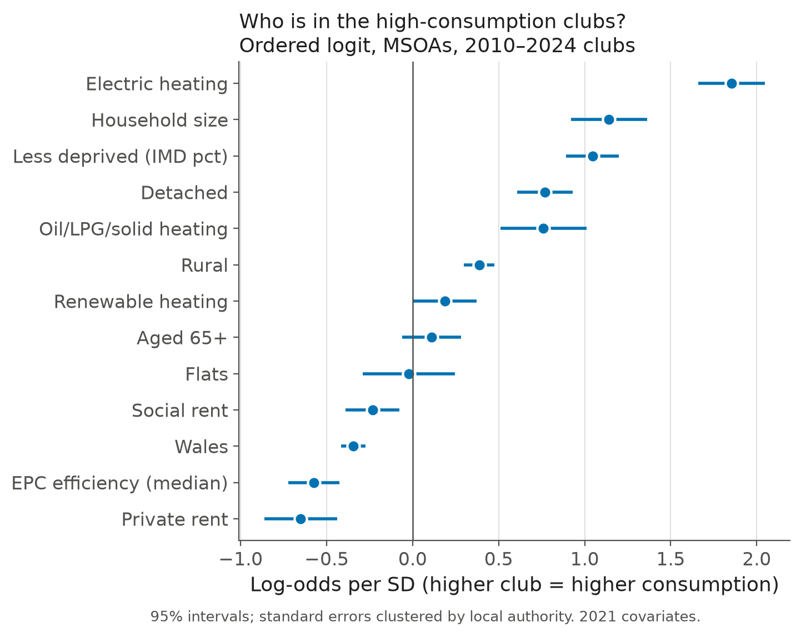{#fig-profile width=75%}

```{python}
#| label: lad-map-data
#| code-summary: "Export simplified LAD polygons and indicators to Observable JS"
lad = gpd.read_parquet(PROC / "lad21_ew.parquet")[["lad_cd", "lad_nm", "geometry"]]
panel = read(PROC, "elec_lad_panel")
wide = panel.pivot(index="lad_cd", columns="year", values="mean_kwh")
ew = panel.groupby("year").apply(lambda d: d.total_kwh.sum() / d.meters.sum())
clubs = read(MOD, "clubs_membership_lad")[["lad_cd", "lad_full"]]
ind = pd.DataFrame({
    "lad_cd": wide.index.to_numpy(),
    "kwh_2024": wide[2024].round(0),
    "rel_2024": (wide[2024] / ew[2024]).round(3),
    "change_pct": (100 * (wide[2024] / wide[2010] - 1)).round(1),
}).reset_index(drop=True).merge(clubs, on="lad_cd", how="left")
lad = lad.merge(ind, on="lad_cd")
lad["geometry"] = lad.geometry.simplify(400, preserve_topology=True)
# drop slivers under 1 km²: after rounding they collapse to zero-area rings, which d3 reads as inverted
parts = lad[["lad_cd", "geometry"]].explode(index_parts=False)
parts = parts[parts.area > 1e6].dissolve("lad_cd")
lad = lad.drop(columns="geometry").merge(parts.reset_index(), on="lad_cd").set_geometry("geometry")
lad = lad.set_crs(27700, allow_override=True).to_crs(4326)
import shapely
# ~10 m precision keeps the embedded GeoJSON small (display only; validity is not needed)
lad["geometry"] = shapely.transform(lad.geometry.values, lambda xy: np.round(xy, 4))
# d3-geo (used by Observable Plot) expects clockwise exterior rings, the reverse of RFC 7946
lad["geometry"] = shapely.orient_polygons(lad.geometry.values, exterior_cw=True)
lad_geojson = lad.rename(columns={"lad_full": "club"}).__geo_interface__
ojs_define(lad_geojson=lad_geojson)
```

```{ojs}
//| code-summary: "Observable JS: indicator selector"
viewof indicator = Inputs.select(
  new Map([
    ["Convergence club, 2010–24 (1 = highest)", "club"],
    ["Relative consumption, 2024 (E&W = 1)", "rel_2024"],
    ["Change in kWh per meter, 2010–24 (%)", "change_pct"],
    ["Mean kWh per meter, 2024", "kwh_2024"]
  ]),
  {label: "Show"}
)
```

```{ojs}
//| code-summary: "Observable JS: LAD choropleth"
Plot.plot({
  width: Math.min(width, 640),
  height: Math.min(width, 640) * 1.15,
  projection: {type: "transverse-mercator", rotate: [2, 0], domain: lad_geojson},
  color: {
    legend: true,
    type: indicator === "club" ? "ordinal" : "quantize",
    domain: indicator === "club" ? d3.range(1, 13) : undefined,
    n: indicator === "club" ? undefined : 7,
    scheme: indicator === "change_pct" ? "rdbu" : "ylgnbu",
    reverse: indicator === "club",
    label: indicator
  },
  marks: [
    Plot.geo(lad_geojson, {
      // club 0 = divergent authorities: left unfilled rather than coloured as a club
      fill: d => (indicator === "club" && d.properties.club === 0) ? undefined : d.properties[indicator],
      stroke: "currentColor", strokeOpacity: 0.25, strokeWidth: 0.3
    }),
    Plot.tip(lad_geojson.features, Plot.pointer(Plot.centroid({
      geometry: d => d.geometry,
      title: d => `${d.properties.lad_nm}\n${d.properties.club === 0 ? "Divergent" : "Club " + d.properties.club} ·${d.properties.kwh_2024} kWh (2024)\nRelative ${d.properties.rel_2024} · change ${d.properties.change_pct}%`
    })))
  ]
})
```

*Interactive map of the 318 local authorities. Choose an indicator; hover or tap for values. The five divergent authorities are left unfilled on the club map.*

### What explains the cross-section?

```{python}
#| label: tbl-models
#| tbl-cap: "Model comparison for log consumption per meter, 2022–2024 average, MSOAs (n = 7,264, 13 standardised covariates)."
mc = read(MOD, "xs_msoa_y2224_model_comparison")
t = mc[["model", "k", "AICc", "delta_AICc", "pseudo_R2", "resid_moran_I"]]
t.columns = ["Model", "Parameters (ENP)", "AICc", "ΔAICc", "Pseudo-R²", "Residual Moran's I"]
show_table(t, floatfmt=(None, ".0f", ".0f", ".0f", ".3f", ".2f"))
```

Small-area consumption is highly predictable from housing and heating composition: census, EPC and deprivation covariates explain about 79% of the variance between LSOAs and 80% between MSOAs, with the same ranking in 2019 and 2022–24 (@fig-forest). Dwelling size (mean rooms) and electric central heating each add about 11–12% per SD, off-gas heating about 5% and household size about 4%; density, district heating and Wales carry negative associations. EPC efficiency has the expected negative sign but a small coefficient, consistent with modelled efficiency being a weak proxy for realised demand [@few2023overprediction; @summerfield2019empirical].

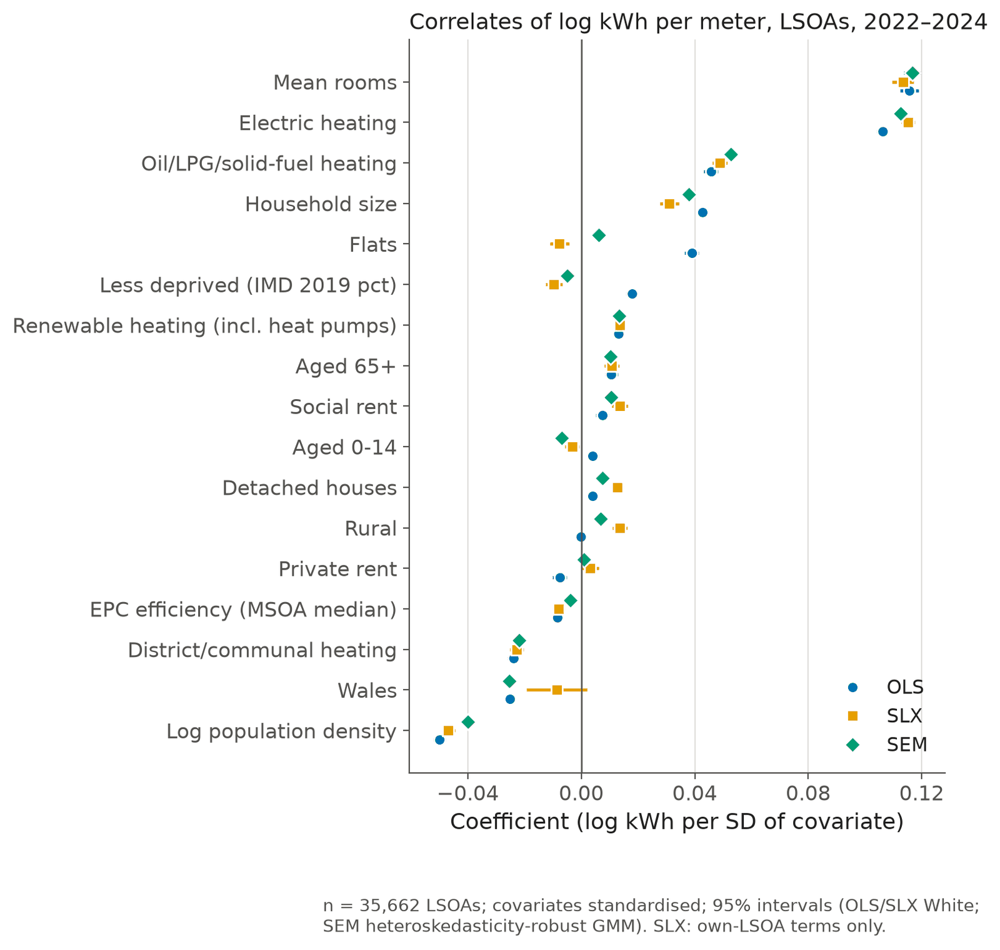{#fig-forest width=85%}

The residuals are strongly spatially autocorrelated, and the robust LM tests point to error dependence (robust LM-error 13,326 against robust LM-lag 2.1, *p* = 0.15), not a substantive spillover. Spatial-error and Durbin-type models remove the residual autocorrelation; the spatial lag model does not. We read this as unmeasured, spatially smooth context: climate, housing vintage, network and tariff history. Separating own from neighbourhood deprivation (SDEM) reverses the sign of the deprivation coefficient: within its surroundings a less deprived LSOA consumes slightly *less* per meter (−0.009), while living among less deprived neighbourhoods raises consumption (+0.026). The positive raw association between affluence and consumption is a regional gradient, not a within-neighbourhood one [@openshaw1984modifiable].

```{python}
#| label: tbl-mgwr
#| tbl-cap: "MGWR (MSOAs, 2022–2024): covariate-specific bandwidths (nearest MSOAs of 7,264), local coefficients and share of MSOAs significant after the corrected critical t."
ls = read(MOD, "xs_mgwr_msoa_y2224_local_summary").sort_values("bandwidth_nn")
labels = {"const": "Intercept", "share_ch_electric": "Electric heating", "share_ch_offgas": "Off-gas heating",
          "share_ch_renewable": "Renewable heating", "mean_hh_size": "Household size",
          "share_detached": "Detached", "share_flat": "Flats", "mean_rooms": "Mean rooms",
          "share_social_rent": "Social rent", "share_private_rent": "Private rent",
          "share_age_65plus": "Aged 65+", "dep19_pct": "Less deprived", "epc_ee": "EPC efficiency",
          "log_density": "Log density"}
t = pd.DataFrame({"Covariate": ls.term.map(labels).fillna(ls.term), "Bandwidth": ls.bandwidth_nn,
                  "Mean β": ls["mean"], "Min β": ls["min"], "Max β": ls["max"],
                  "Significant %": 100 * ls.share_sig})
show_table(t, floatfmt=(None, ".0f", ".2f", ".2f", ".2f", ".0f"))
```

Relationships vary strongly over space. GWR and MGWR raise *R*² to about 0.95 and cut AICc by 2,500–2,700 relative to the best global model (@tbl-models). GWR's single bandwidth (178 MSOAs) gives the lowest AICc, so MGWR's extra flexibility is not rewarded on information criteria; its value lies in what its bandwidths reveal about the *scale* of each process (@tbl-mgwr, @fig-bw). Age structure acts at a national scale and log density near-nationally; off-gas heating, social renting and flats regionally; electric heating, EPC efficiency, private renting and renewable heating locally (about 250–300 MSOAs). Electric heating is positive and significant everywhere, strongest in inner London where electrically heated flats are concentrated and weakest in Surrey (@fig-mgwr-elec). EPC efficiency is significantly negative in 40% of MSOAs and never significantly positive (@fig-mgwr-epc). Household size and detached share have the smallest bandwidths but are rarely significant after correction.

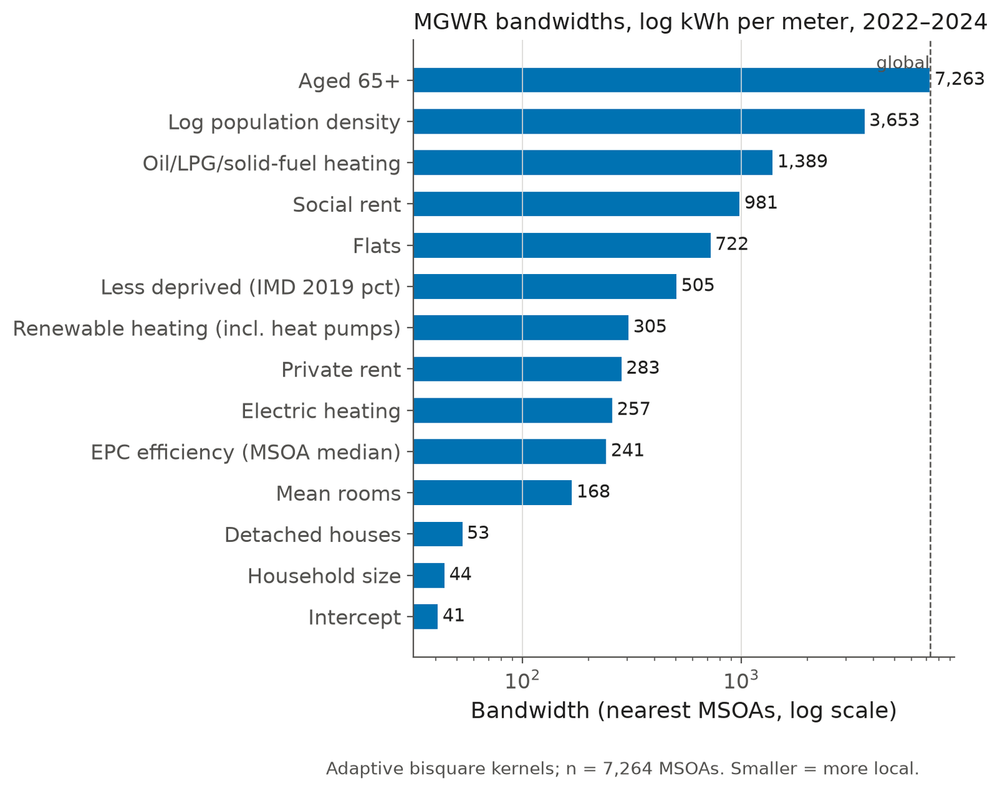{#fig-bw width=85%}

::: {layout-ncol=2}
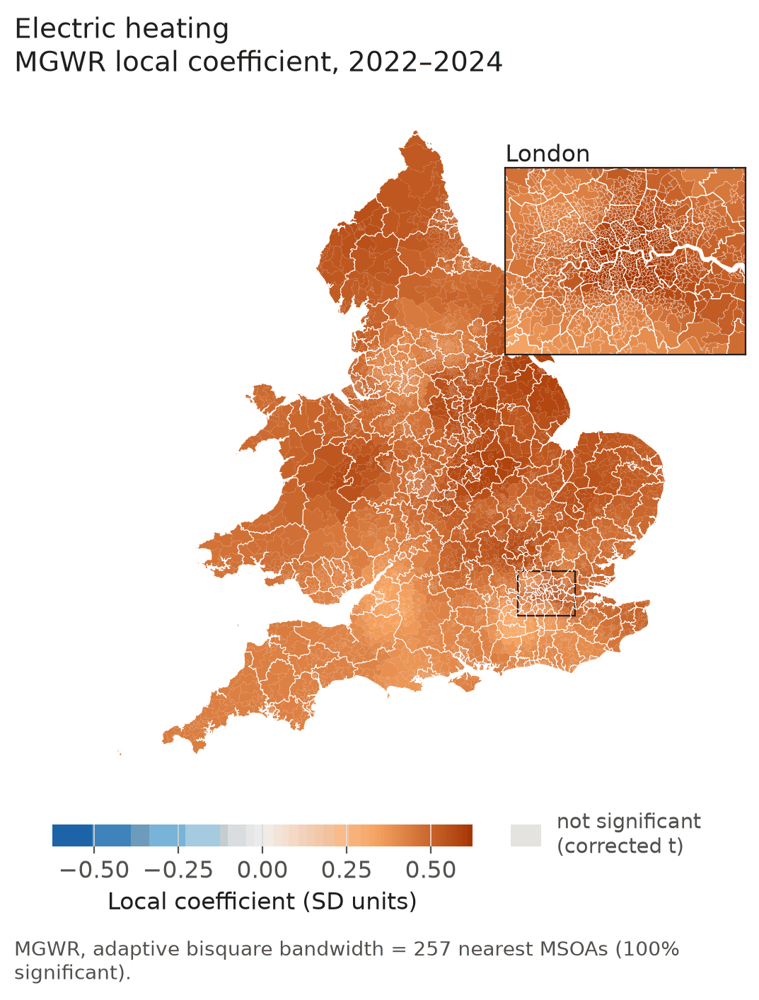{#fig-mgwr-elec}

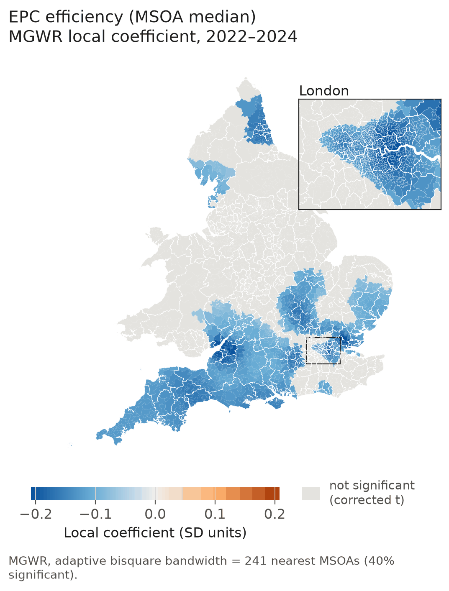{#fig-mgwr-epc}
:::

### Change, shocks and electrification

```{python}
#| label: tbl-beta
#| tbl-cap: "β-convergence regressions of the change in log consumption on the initial level: long change (2010–12 → 2022–24) and shock change (2019 → 2022)."
bc = read(MOD, "ch_beta_convergence")
t = bc[["level", "change", "spec", "n", "beta", "t", "mean_change"]].copy()
t["level"] = t.level.str.upper()
t["change"] = t.change.map({"long": "2010–12 → 2022–24", "shock": "2019 → 2022"})
t.columns = ["Scale", "Change", "Specification", "n", "β", "t", "Mean Δlog"]
show_table(t, floatfmt=(None, None, None, ".0f", ".3f", ".1f", ".3f"))
```

Consumption per meter fell by about 19% over 2010–12 → 2022–24 and by about 11% over 2019 → 2022 at every scale. Unconditionally, higher-consuming places fell slightly *less* in proportion over the long run (weak β-divergence; @tbl-beta), matching the Phillips–Sul result and the rise in σ, but fell *more* in the 2022 shock. Holding 2021 composition constant, the places that fell least over 2010–24 were electrically heated, large-dwelling, rented and heat-pump areas, while new-build growth and density went with larger falls (@fig-change). The conditional level coefficient is strongly negative, but it is inflated by regression to the mean in a noisy baseline and should not be read as behavioural catch-up. For the long change MGWR is the best-fitting model (AICc 13,398 against 13,512 for GWR and 14,806 for SDM): heat-pump heating, dwelling size, social renting, deprivation and density act uniformly across the country, electric heating, private renting and EPC efficiency locally, and the level effect and new-build dilution very locally (@fig-change-bw). Domestic solar PV installed under the Feed-in Tariff shows no association with either change at LAD level once housing and heating are controlled; with coarse, pre-2019 installation counts that are confounded with detached owner-occupation, this is not evidence that solar leaves net consumption unchanged [@mckenna2018solar].

::: {layout-ncol=2}
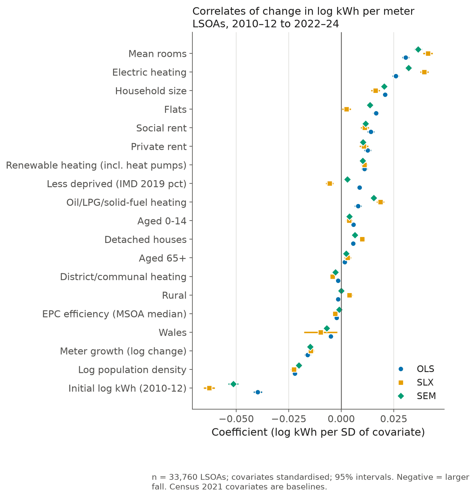{#fig-change}

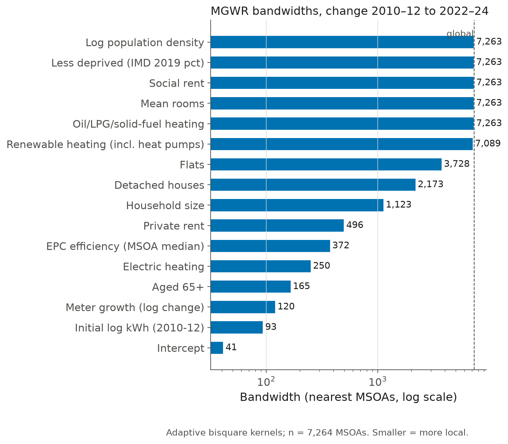{#fig-change-bw}
:::

The event study (@fig-event) traces how the consumption gap associated with each 2021 baseline evolved, relative to 2019, in a two-way fixed-effects panel of 33,750 LSOAs. Three signatures stand out. **Heat pumps:** areas with more renewable heating have drifted almost linearly upwards relative to others since 2010, by about 1.3% per SD over the period, and the drift continued through the price crisis, the expected footprint of the electrification of heat [@love2017addition; @arvanitopoulos2025decarbonising]. **COVID-19:** less deprived and detached-housing areas rose most in 2020–21 and fell back by 2022. **Electric heating:** electrically heated areas did *not* cut more than others in 2022; relative to 2019 they rose slightly, then oscillated with winter temperatures, which the non-weather-corrected series cannot separate. In the panel itself, growth in meter counts lowers the mean (new-build dilution, elasticity −0.09) and more residents per meter raise it (+0.16).

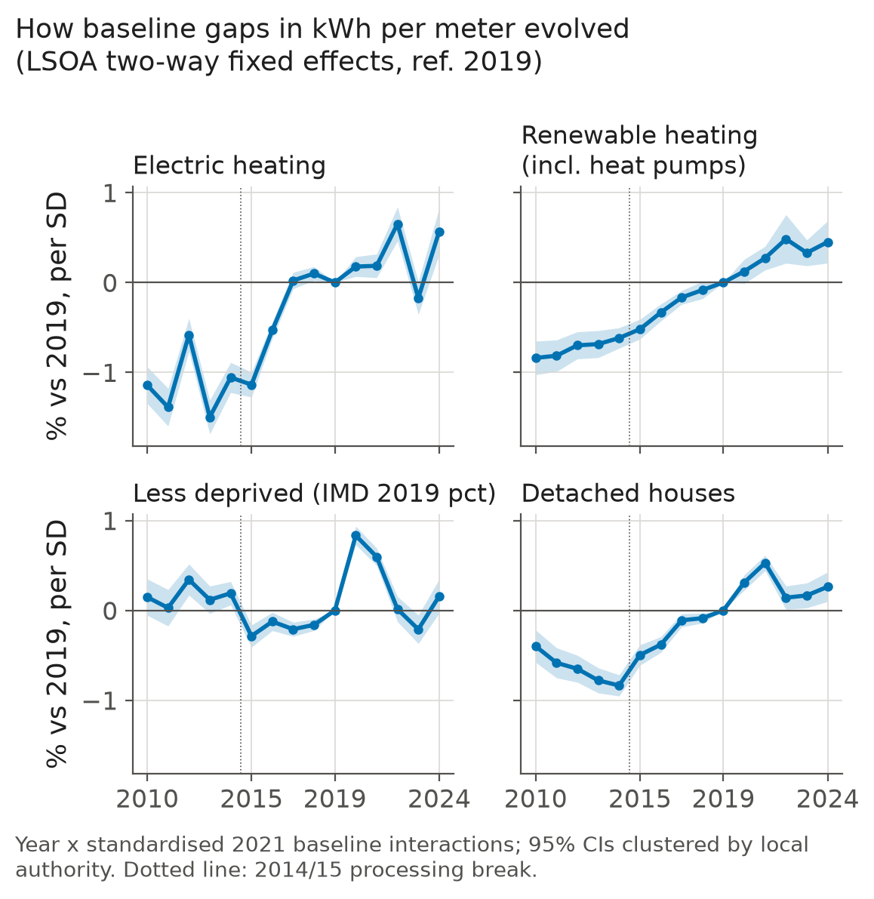{#fig-event width=80%}

The basis-function trend surface (@fig-trend) shows that the large-scale geography is stable: the 2024 surface is almost the 2010 surface with slightly larger amplitude. It explains only 17–20% of the cross-sectional variance; the persistent fine-scale (below 25 km) LSOA component accounts for 67–83%. Most spatial variation is therefore neighbourhood-scale and persistent, which is why convergence clubs sort neighbourhoods rather than regions.

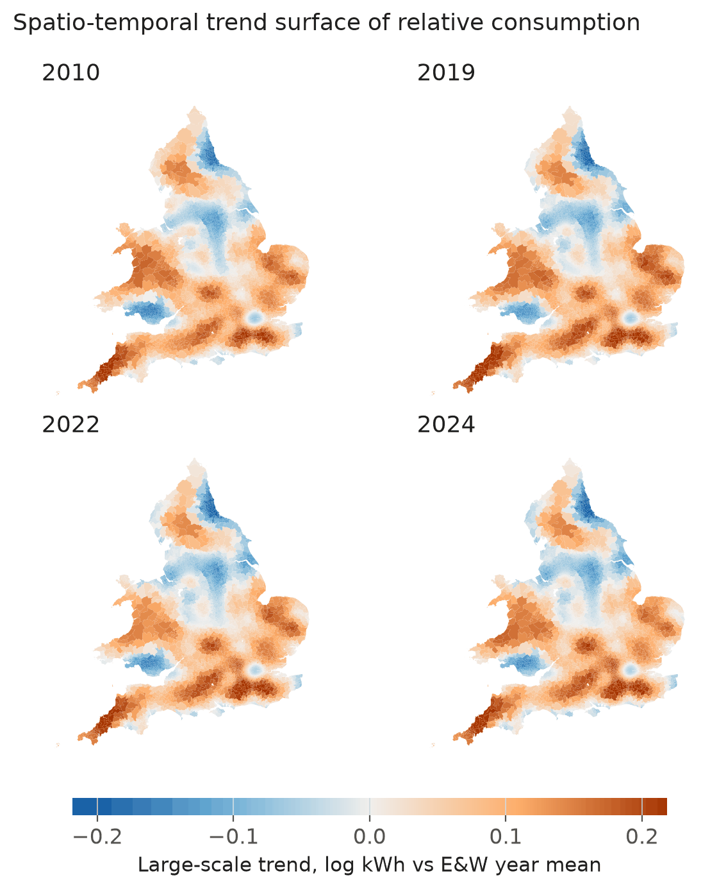{#fig-trend}

### Robustness

No substantive conclusion depends on the outlier flags, the split LSOAs, the weights or the inference method. Excluding flagged LSOAs changes Moran's *I* by at most 0.011, Markov diagonals by at most 0.003 and the spatial-Markov contrast hardly at all. Gas, which is weather-corrected, offers a useful contrast on the 34,551 LSOAs with both fuels (@fig-gas): its clustering is similar (*I* 0.50–0.53), its inequality is flat rather than rising, it is about half as mobile (Shorrocks 0.13 against 0.25), and its spatial conditioning runs in the same direction but is weaker. Restricting electricity to gas-connected LSOAs lowers its Moran's *I* from 0.58 to 0.52, so much of electricity's clustering comes from off-gas-grid areas where it substitutes for heating fuel [@roberts2015fuel].

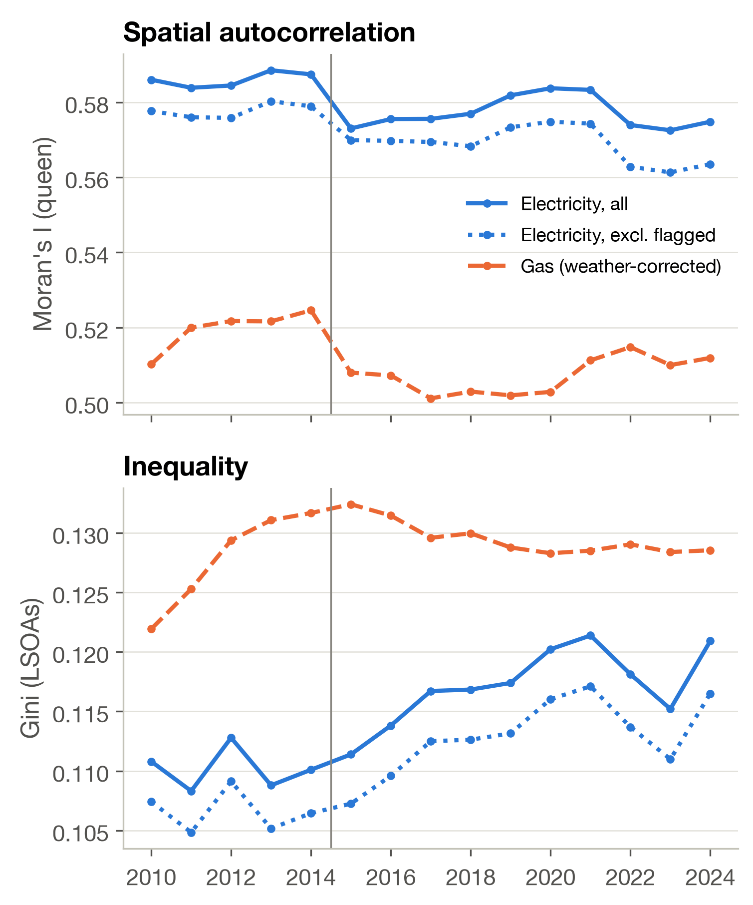{#fig-gas width=85%}

## Discussion

::: {.table-responsive}

| Hypothesis | Verdict | Evidence |
|---|---|---|
| H1a. Moran's *I* positive and significant in every year | Supported | *I* = 0.57–0.59 (queen), 0.39–0.42 (KNN-8); *p* = 0.001 in all years |
| H1b. Within-LAD component dominates the Theil index | Supported | 73–76% within LADs and rising; 31–32% within MSOAs |
| H1c. Within-LAD dispersion rises with LAD mean | Supported | ρ = 0.68–0.76; elasticity ≈ 2.5, robust to all checks |
| H2a. High persistence on Markov diagonals | Supported | LSOA 0.70–0.94, LAD 0.88–0.96; multi-year persistence higher still |
| H2b. Neighbourhood context conditions mobility | Supported | *Q* = 6,150; P(leave Q1) 0.08 vs 0.19 by neighbourhood |
| H2c. Growth dominates mobility in shock years | Supported | 71–82% of LSOA mobility (> 90% for LADs) in 2019–22 |
| H2d. Exchange outweighs dispersion | Supported | Exchange ≈ 10× dispersion; most annual exchange reverses |
| H3. No global convergence; clubs spatially clustered and tied to heating and dwelling type | Supported | *t* = −27 to −95; Moran's *I* of club 0.41–0.58; electric-heating OR 6.4 |
| H4a. Household size and detached share act at near-global scales | Rejected | Smallest MGWR bandwidths (44 and 53 MSOAs), rarely significant |
| H4b. Heating-fuel and EPC effects local and robust to spatial dependence | Partly supported | Electric heating and EPC local, off-gas regional; signs stable under SEM/SDEM |
| H5a. Relative inequality fell in 2022 as high-consuming areas cut most | Partly supported | Top quintile −9.6% vs −6.8%; Gini compressed to 2023, recovered in 2024 |
| H5b. Deprived, low-consumption areas cut least | Supported (area level) | −6.8% most deprived vs −10.0% least deprived, monotonic |

: Hypotheses and verdicts. {#tbl-hypotheses}

:::

The geography of domestic electricity use in England and Wales is remarkably durable (@tbl-hypotheses). Over fifteen years in which consumption per meter fell by a fifth and the system absorbed a pandemic and a price shock, the spatial pattern, its level of clustering and the relative positions of places barely changed. Inequality between neighbourhoods rose slowly, and it rose *within* places rather than between regions. This matters for policy. Area-based support allocated at local-authority level will miss most of the variation, because three quarters of it lies inside authorities, and the most internally unequal authorities are precisely the high-consumption rural districts where electrically heated, off-gas neighbourhoods sit beside gas-heated towns. Targeting at LSOA or MSOA scale, informed by heating fuel and dwelling size, is far better matched to where consumption differs.

The dynamics add a second message: persistence is self-reinforcing in space. Places surrounded by low-consumption neighbourhoods are roughly half as likely to move up, and high-consumption places among high-consumption neighbours almost never move down. Combined with the convergence-club evidence of graded, spatially clustered strata, this suggests that local housing and heating systems lock in consumption levels, so changing them requires changing the stock, not waiting for diffusion. The shocks of 2020–2022 moved the whole distribution, with only brief and partial compression of relative differences; deprived areas cut least in 2022, consistent with households that had little discretionary use left [@zapatawebborn2024winter; @fawcett2024using]. Finally, electrification is already visible: heat-pump areas have drifted steadily upwards relative to the rest of the country. As heat pumps spread, per-meter electricity will increasingly measure the decarbonisation of heat rather than affluence or need, and analyses of energy inequality will have to read high consumption more carefully.

### Limitations

- **Ecological inference and MAUP.** All covariates are area shares and the outcome is a per-meter mean, so every association describes places, not households, and its magnitude depends on the zoning [@openshaw1984modifiable; @fotheringham1991modifiable]. Key results were repeated at MSOA and LAD scale.
- **Meters, not households, and no weather correction.** Economy 7, second homes, communal supplies and estimated readings distort small-area means; part of the year-to-year movement in electricity reflects winter temperatures.
- **Geography and processing break.** 2010–2014 are converted from 2011 LSOAs and come from an earlier DESNZ system; 2015–2024 is the core period, and the break is quantified.
- **Short panels for convergence tests.** With *T* = 10–15 and very large *N*, the Phillips–Sul procedure finds many fine strata; club ordering is robust, club boundaries are not.
- **Cross-sectional covariates.** Census 2021 baselines say which kinds of place changed more, not why; mechanisms such as the timing of heat-pump installations or retrofit are not observed. EPC data cover only dwellings sold, let or built since 2008 [@hardy2019analysis].
- **Local-model complexity.** GWR and MGWR use about 1,000–1,350 effective parameters and local collinearity is highest in inner London; their maps describe where associations differ rather than giving precise local estimates.

## Conclusion

Using fifteen years of meter-based statistics for every neighbourhood in England and Wales, this study shows that domestic electricity consumption is spatially clustered, mostly unequal within rather than between local authorities, highly persistent, conditioned by neighbourhood context and stratified into ordered, spatially concentrated convergence clubs rather than converging. Housing and heating composition explains most of the cross-section, but its associations operate at distinct spatial scales. The pandemic and the 2022 price crisis shifted the whole distribution without lasting change to the relative positions of places, and the electrification of heat is emerging as a new source of divergence. Future work should add regional degree-days to separate weather from behaviour, link small-area heat-pump, solar and EV installation records, and extend the analysis to gas and total energy to describe the full transition in household demand.

## Data and code availability {.unnumbered}

All data are official statistics from DESNZ, ONS, MHCLG and the Welsh Government under the Open Government Licence v3.0 (Contains OS data © Crown copyright and database right). The full pipeline is in this project's folder: `prep/` downloads and harmonises the raw data (`run_all.py`, with a source and checksum manifest), `analysis/` runs the dynamics (`run_dynamics.py`) and models (`b_run_models.py`), and `analysis/c_page_figures.py` prepares the figures shown here. The code cells on this page read the cached result tables those scripts write.

## References {.unnumbered}

::: {#refs}
:::
